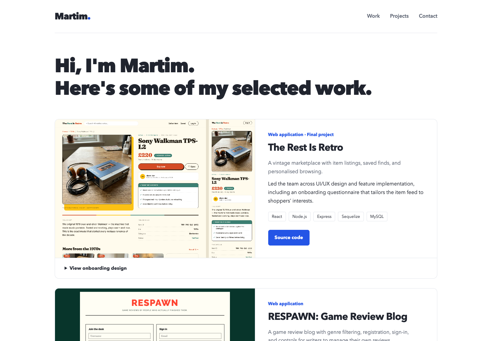

# Martim portfolio

A growing portfolio of websites, applications, and creative work.
Includes selected projects, a filterable project collection, and contact links.

**Stack:** React, React Router, Vite, JavaScript, plain CSS.

## Run locally

Use Node.js 22.12 or later.

```sh
npm ci
npm run dev
```

Build: `npm run build`. Preview the build: `npm run preview`.

## Add work

Add a record to `src/data/projects.json`. Set `featured` to show it in the Home highlights.
Use labelled links for a live project, source code, Figma design, or gallery.

## Preview



## Links

- [GitHub repository](https://github.com/MartimLou42/bootcamp): portfolio changes await a push.
- Live portfolio: not deployed yet.

## Deployment

Render settings are in the repository-root `render.yaml`: static site, root `react-portfolio`,
build `npm ci && npm run build`, publish `dist`, and rewrite `/*` to `/index.html`.
Push the reviewed branch before creating the site. After deployment, check `/` and `/projects`
and replace the pending live link above.

Retro uses supplied design screenshots; no live demo is confirmed. The Python project is a command-line tool.
Some linked Render apps may take a moment to wake up.
